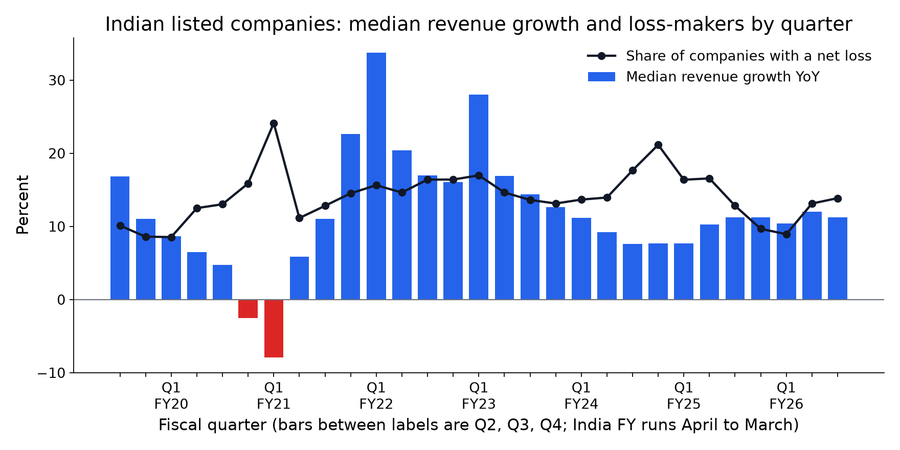
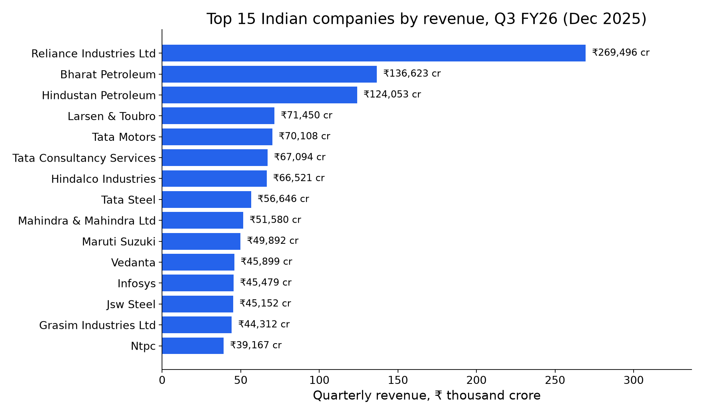
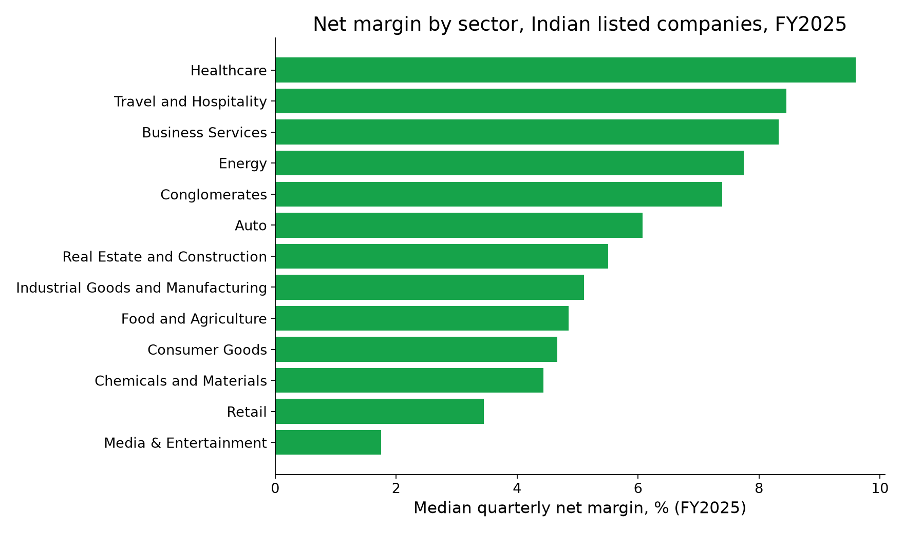

# India Quarterly Results 2019-2026 (NSE/BSE): findings, method and data card

> India quarterly results data: 32,146 company-quarters of revenue, net profit, EBITDA and YoY growth for 4,474 NSE/BSE-listed firms, Dec 2018 to Mar 2026.

*Fliar Research · released October 2026 · licence CC BY-NC 4.0*

**How this dataset was acquired.** Every row comes from the [Radar API](https://github.com/fliarbi/radar-api-mcp), Fliar's company-data API and MCP server. Radar collects
the quarterly financial results that Indian listed companies file with the stock exchanges (NSE and BSE), reads the results tables and
maps each line to a common set of metrics. It also reads business news continuously and extracts the results that companies announce
(revenue, net profit, EBITDA and growth figures stated in the report), checking each figure against the sentence it came from.
This release merges the two into one row per company and quarter, from the December 2018 quarter to the March 2026 quarter, with
exchange-filed figures preferred, unit errors (lakh / crore / rupee slips) removed and year-on-year growth computed against the same
quarter a year earlier. The full quarterly income statement for any company, plus annual results, balance sheet and cash flow, is
available through `POST /v1/companies/financials` ([reference](https://github.com/fliarbi/radar-api-mcp/blob/main/docs/reference/get_financials.md)) or the `get_financials` MCP tool.

> **This file is a 25% sample: 8,039 of 32,146 company-quarters.** It keeps every record for a fixed subset of companies.
> The subset is chosen by a hash, so it stays the same from one release to the next. The findings and tables below were computed
> on the **full** data. For the rest, the withheld fields and monthly updates, [get a Radar API key](https://fliarbi.com/radar-api/developer) ([docs](https://github.com/fliarbi/radar-api-mcp)).
> Each row's `fliar_profile_url` opens the company's full profile on Fliar.

## Key findings

1. **32,146 quarterly results for 4,474 Indian listed companies, Q3 FY19 (Dec 2018) to Q4 FY26 (Mar 2026).** 11,518 come from stock-exchange result filings and 20,628 from results reported in business news.
2. **Latest full quarter, Q3 FY26 (Dec 2025):** 1,349 companies. Reliance Industries Ltd had the highest revenue (₹269,496 cr), followed by Bharat Petroleum (₹136,623 cr) and Hindustan Petroleum (₹124,053 cr).
3. **The median company grew revenue 11.3% year on year in Q3 FY26 (Dec 2025)**; 78% of the 627 companies with a growth figure grew.
4. **The pandemic quarter shows clearly:** median revenue growth was -7.9% in Q1 FY21 (April–June 2020), and the strongest quarter since 2021 was Q1 FY22 (Jun 2021) at +33.7% (the rebound against a depressed base).
5. **Loss-makers:** 14% of companies reporting a net profit figure in Q3 FY26 (Dec 2025) posted a loss, against 24% in Q1 FY21.
6. **Margins by sector, FY2025** (sectors with 100+ results): the highest median net margin was in Healthcare (9.6%), the lowest in Media & Entertainment (1.8%).

### Top 50 Indian companies by quarterly revenue, Q3 FY26 (Dec 2025)

Revenue from operations in ₹ crore (1 crore = 10 million rupees). Banks, NBFCs and insurers appear only when their revenue was filed on the exchange; see the profit table for them. Consolidated figures where the company files both.

| #   | Company                                   | Domain                 | Sector                       | Revenue     | Revenue (US$)   | Net profit   | EBITDA     | Revenue YoY   | Net profit YoY   | Basis        |
|:----|:------------------------------------------|:-----------------------|:-----------------------------|:------------|:----------------|:-------------|:-----------|:--------------|:-----------------|:-------------|
| 1   | Reliance Industries Ltd                   | ril.com                | Telecom                      | ₹269,496 cr | $32.3B          | ₹22,167 cr   | ₹36,325 cr | +10.5%        | +4.8%            | consolidated |
| 2   | Bharat Petroleum                          | bharatpetroleum.in     | Energy                       | ₹136,623 cr | $16.4B          | ₹7,545 cr    | ₹11,677 cr | +20.8%        |                  | standalone   |
| 3   | Hindustan Petroleum                       | hindustanpetroleum.com | Energy                       | ₹124,053 cr | $14.9B          | ₹4,011 cr    | ₹7,019 cr  | +4.3%         |                  | consolidated |
| 4   | Larsen & Toubro                           | larsentoubro.com       | Conglomerates                | ₹71,450 cr  | $8.6B           | ₹3,215 cr    |            | +10.0%        |                  | consolidated |
| 5   | Tata Motors                               | tatamotors.com         | Auto                         | ₹70,108 cr  | $8.4B           | ₹-3,483 cr   | ₹918 cr    | -30.9%        | -201.0%          | consolidated |
| 6   | Tata Consultancy Services                 | tcs.com                | Business Services            | ₹67,094 cr  | $8.1B           | ₹13,230 cr   | ₹18,453 cr | +4.9%         |                  |              |
| 7   | Hindalco Industries                       | hindalco.com           | Chemicals and Materials      | ₹66,521 cr  | $8.0B           | ₹2,049 cr    |            |               |                  | consolidated |
| 8   | Tata Steel                                | tatasteel.com          | Chemicals and Materials      | ₹56,646 cr  | $6.8B           | ₹2,690 cr    |            |               |                  | consolidated |
| 9   | Mahindra & Mahindra Ltd                   | mahindra.com           | Conglomerates                | ₹51,580 cr  | $6.2B           | ₹3,931 cr    |            | +24.4%        |                  | consolidated |
| 10  | Maruti Suzuki                             | marutisuzuki.com       | Auto                         | ₹49,892 cr  | $6.0B           | ₹4,410 cr    |            |               | +25.1%           | standalone   |
| 11  | Vedanta                                   | vedantalimited.com     | Conglomerates                | ₹45,899 cr  | $5.5B           | ₹7,807 cr    |            | +19.0%        |                  |              |
| 12  | Infosys                                   | infosys.com            | Business Services            | ₹45,479 cr  | $5.5B           | ₹6,666 cr    | ₹10,484 cr | +8.9%         | -2.3%            | consolidated |
| 13  | Jsw Steel                                 | jswsteel.in            | Chemicals and Materials      | ₹45,152 cr  | $5.4B           | ₹1,646 cr    | ₹7,311 cr  | +11.1%        |                  | consolidated |
| 14  | Grasim Industries Ltd                     | grasim.com             | Chemicals and Materials      | ₹44,312 cr  | $5.3B           | ₹1,037 cr    | ₹8,925 cr  | +25.3%        |                  |              |
| 15  | Ntpc                                      | ntpc.co.in             | Energy                       | ₹39,167 cr  | $4.7B           | ₹4,653 cr    | ₹11,542 cr | +2.0%         |                  | standalone   |
| 16  | Coal India                                | coalindia.in           | Energy                       | ₹34,924 cr  | $4.2B           | ₹7,166 cr    | ₹9,331 cr  | -2.4%         | -15.2%           |              |
| 17  | Gail                                      | gailonline.com         | Energy                       | ₹34,076 cr  | $4.1B           | ₹1,603 cr    | ₹3,335 cr  | -4.4%         |                  | standalone   |
| 18  | Hcl Technologies                          | hcltech.com            | Business Services            | ₹33,872 cr  | $4.1B           | ₹4,076 cr    |            | +13.3%        | -11.3%           |              |
| 19  | Reliance Jio                              | jio.com                | Telecom                      | ₹32,751 cr  | $3.9B           | ₹7,173 cr    | ₹18,408 cr | -1.0%         | +4.2%            |              |
| 20  | Ongc                                      | ongcindia.com          | Energy                       | ₹31,547 cr  | $3.8B           | ₹8,372 cr    |            | -6.4%         | +1.6%            |              |
| 21  | Mangalore Refinery And Petrochemicals     | mrpl.co.in             | Energy                       | ₹29,720 cr  | $3.6B           | ₹1,445 cr    |            | +16.1%        |                  |              |
| 22  | Adani Enterprises Ltd                     | adanienterprises.com   | Conglomerates                | ₹25,475 cr  | $3.1B           | ₹6,296 cr    | ₹4,297 cr  | +8.0%         |                  |              |
| 23  | Wipro                                     | wipro.com              | Business Services            | ₹23,555 cr  | $2.8B           | ₹3,119 cr    |            | +5.5%         | -7.0%            | consolidated |
| 24  | UltraTech Cement Ltd                      | ultratechcement.com    | Real Estate and Construction | ₹21,830 cr  | $2.6B           | ₹1,729 cr    |            | +27.0%        | +17.4%           | consolidated |
| 25  | Itc                                       | itcportal.com          | Food and Agriculture         | ₹19,200 cr  | $2.3B           | ₹5,018 cr    |            | +7.1%         | +0.1%            | consolidated |
| 26  | Avenue Supermarts Ltd                     | dmartindia.com         | Retail                       | ₹18,101 cr  | $2.2B           | ₹856 cr      | ₹1,480 cr  | +13.2%        |                  | consolidated |
| 27  | Hyundai Motor India                       | hyundaimotor.in        | Auto                         | ₹17,974 cr  | $2.2B           | ₹1,234 cr    | ₹2,018 cr  | +8.0%         | +6.3%            |              |
| 28  | Redington                                 | redingtongroup.com     | Business Services            | ₹16,271 cr  | $2.0B           | ₹223 cr      | ₹338 cr    |               |                  | standalone   |
| 29  | Hindustan Unilever Ltd                    | hul.co.in              | Consumer Goods               | ₹16,235 cr  | $1.9B           | ₹6,603 cr    | ₹3,788 cr  | +6.0%         |                  | consolidated |
| 30  | Sun Pharmaceutical Industries             | sunpharma.com          | Healthcare                   | ₹15,520 cr  | $1.9B           | ₹3,369 cr    | ₹4,948 cr  | +13.0%        | +16.0%           | consolidated |
| 31  | Bajaj Auto                                | bajajauto.com          | Auto                         | ₹15,220 cr  | $1.8B           | ₹2,502 cr    | ₹3,161 cr  | +18.8%        |                  |              |
| 32  | Ashok Leyland                             | ashokleyland.com       | Auto                         | ₹15,011 cr  | $1.8B           | ₹813 cr      |            | +24.5%        |                  | consolidated |
| 33  | Tvs Motor Company                         | tvsmotor.com           | Auto                         | ₹14,745 cr  | $1.8B           | ₹891 cr      |            | +33.0%        |                  | consolidated |
| 34  | Tech Mahindra Ltd                         | techmahindra.com       | Business Services            | ₹14,393 cr  | $1.7B           | ₹1,122 cr    |            | +8.0%         |                  |              |
| 35  | Adani Power                               | adanipower.com         | Energy                       | ₹12,717 cr  | $1.5B           | ₹2,480 cr    | ₹4,636 cr  | -9.0%         | -15.6%           | consolidated |
| 36  | Power Grid Corporation Of India           | powergrid.in           | Energy                       | ₹12,599 cr  | $1.5B           | ₹4,185 cr    |            | +9.1%         |                  | consolidated |
| 37  | ABB India Ltd                             |                        |                              | ₹12,504 cr  | $1.5B           | ₹1,668 cr    |            | +2.6%         |                  | consolidated |
| 38  | Hero Motocorp                             | heromotocorp.com       | Auto                         | ₹12,487 cr  | $1.5B           | ₹1,275 cr    | ₹1,930 cr  | +21.0%        |                  | consolidated |
| 39  | Upl                                       | upl-ltd.com            | Food and Agriculture Tech    | ₹12,269 cr  | $1.5B           | ₹396 cr      | ₹2,433 cr  | +12.5%        |                  |              |
| 40  | Vodafone Idea                             | vodafone.in            | Telecom                      | ₹11,323 cr  | $1.4B           | ₹-5,286 cr   | ₹4,816 cr  | +2.0%         |                  | consolidated |
| 41  | Hindustan Zinc                            | hzlindia.com           | Mining                       | ₹11,000 cr  | $1.3B           | ₹3,916 cr    | ₹6,054 cr  | +27.0%        |                  | consolidated |
| 42  | Ltimindtree                               | ltimindtree.com        | Business Services            | ₹10,781 cr  | $1.3B           | ₹960 cr      |            | +11.6%        | -11.7%           |              |
| 43  | Patanjali Foods                           | patanjalifoods.com     | Food and Agriculture         | ₹10,483 cr  | $1.3B           | ₹364 cr      | ₹433 cr    | +16.5%        |                  |              |
| 44  | EID Parry (India)                         | eidparry.com           | Food and Agriculture         | ₹10,375 cr  | $1.2B           | ₹437 cr      |            |               |                  | consolidated |
| 45  | Adani Ports and Special Economic Zone Ltd | adaniports.com         | Transportation and Logistics | ₹9,705 cr   | $1.2B           | ₹3,043 cr    |            | +37.3%        | +26.1%           | consolidated |
| 46  | Asian Paints                              | asianpaints.com        | Chemicals and Materials      | ₹8,867 cr   | $1.1B           | ₹1,060 cr    |            | +3.7%         |                  |              |
| 47  | Coromandel International                  | coromandel.biz         | Food and Agriculture         | ₹8,863 cr   | $1.1B           | ₹488 cr      |            | +27.8%        | -5.5%            |              |
| 48  | Dr. Reddy'S Laboratories                  | drreddys.com           | Healthcare                   | ₹8,727 cr   | $1.0B           | ₹1,210 cr    |            | +4.4%         | -14.4%           | consolidated |
| 49  | Aurobindo Pharma                          | aurobindo.com          | Healthcare                   | ₹8,646 cr   | $1.0B           | ₹1,774 cr    |            | +8.4%         |                  |              |
| 50  | Bharat Heavy Electricals                  | bhel.com               | Energy                       | ₹8,446 cr   | $1.0B           | ₹295 cr      | ₹593 cr    | +16.0%        |                  |              |

### Top 50 Indian companies by quarterly net profit, Q3 FY26 (Dec 2025)

Net profit after tax. Includes banks and insurers.

| #   | Company                                   | Domain                 | Sector                          | Revenue     | Revenue (US$)   | Net profit   | EBITDA     | Revenue YoY   | Net profit YoY   | Basis        |
|:----|:------------------------------------------|:-----------------------|:--------------------------------|:------------|:----------------|:-------------|:-----------|:--------------|:-----------------|:-------------|
| 1   | Reliance Industries Ltd                   | ril.com                | Telecom                         | ₹269,496 cr | $32.3B          | ₹22,167 cr   | ₹36,325 cr | +10.5%        | +4.8%            | consolidated |
| 2   | State Bank Of India                       | onlinesbi.sbi          | Financial Services              |             |                 | ₹21,876 cr   |            |               |                  | consolidated |
| 3   | Hdfc Bank                                 | hdfcbank.com           | Financial Services              |             |                 | ₹18,654 cr   |            |               | +8.3%            |              |
| 4   | Tata Consultancy Services                 | tcs.com                | Business Services               | ₹67,094 cr  | $8.1B           | ₹13,230 cr   | ₹18,453 cr | +4.9%         |                  |              |
| 5   | Life Insurance Corporation Of India       | licindia.in            | Financial Services              |             |                 | ₹12,958 cr   |            |               | +17.2%           |              |
| 6   | Icici Bank                                | icicibank.com          | Financial Services              |             |                 | ₹12,538 cr   |            |               |                  | consolidated |
| 7   | Bharti Airtel                             | airtel.com             | Telecom                         |             |                 | ₹8,502 cr    |            |               |                  | standalone   |
| 8   | Ongc                                      | ongcindia.com          | Energy                          | ₹31,547 cr  | $3.8B           | ₹8,372 cr    |            | -6.4%         | +1.6%            |              |
| 9   | Power Finance Corporation                 | pfcindia.com           | Financial Services              |             |                 | ₹8,212 cr    |            |               |                  | consolidated |
| 10  | Vedanta                                   | vedantalimited.com     | Conglomerates                   | ₹45,899 cr  | $5.5B           | ₹7,807 cr    |            | +19.0%        |                  |              |
| 11  | Bharat Petroleum                          | bharatpetroleum.in     | Energy                          | ₹136,623 cr | $16.4B          | ₹7,545 cr    | ₹11,677 cr | +20.8%        |                  | standalone   |
| 12  | Reliance Jio                              | jio.com                | Telecom                         | ₹32,751 cr  | $3.9B           | ₹7,173 cr    | ₹18,408 cr | -1.0%         | +4.2%            |              |
| 13  | Coal India                                | coalindia.in           | Energy                          | ₹34,924 cr  | $4.2B           | ₹7,166 cr    | ₹9,331 cr  | -2.4%         | -15.2%           |              |
| 14  | Infosys                                   | infosys.com            | Business Services               | ₹45,479 cr  | $5.5B           | ₹6,666 cr    | ₹10,484 cr | +8.9%         | -2.3%            | consolidated |
| 15  | Hindustan Unilever Ltd                    | hul.co.in              | Consumer Goods                  | ₹16,235 cr  | $1.9B           | ₹6,603 cr    | ₹3,788 cr  | +6.0%         |                  | consolidated |
| 16  | Axis Bank                                 | axisbank.com           | Financial Services              |             |                 | ₹6,490 cr    |            |               |                  |              |
| 17  | Adani Enterprises Ltd                     | adanienterprises.com   | Conglomerates                   | ₹25,475 cr  | $3.1B           | ₹6,296 cr    | ₹4,297 cr  | +8.0%         |                  |              |
| 18  | Bank Of Baroda                            | bankofbaroda.in        | Financial Services              |             |                 | ₹5,443 cr    |            |               |                  | consolidated |
| 19  | Canara Bank                               | canarabank.com         | Financial Services              |             |                 | ₹5,155 cr    |            |               | +36.3%           |              |
| 20  | Itc                                       | itcportal.com          | Food and Agriculture            | ₹19,200 cr  | $2.3B           | ₹5,018 cr    |            | +7.1%         | +0.1%            | consolidated |
| 21  | Kotak Mahindra Bank                       | kotak.com              | Financial Services              |             |                 | ₹4,924 cr    |            |               |                  | consolidated |
| 22  | Punjab National Bank                      | pnbindia.in            | Financial Services              |             |                 | ₹4,904 cr    |            |               |                  |              |
| 23  | Ntpc                                      | ntpc.co.in             | Energy                          | ₹39,167 cr  | $4.7B           | ₹4,653 cr    | ₹11,542 cr | +2.0%         |                  | standalone   |
| 24  | Union Bank Of India                       | unionbankonline.co.in  | Financial Services              |             |                 | ₹4,623 cr    |            |               |                  |              |
| 25  | Maruti Suzuki                             | marutisuzuki.com       | Auto                            | ₹49,892 cr  | $6.0B           | ₹4,410 cr    |            |               | +25.1%           | standalone   |
| 26  | Power Grid Corporation Of India           | powergrid.in           | Energy                          | ₹12,599 cr  | $1.5B           | ₹4,185 cr    |            | +9.1%         |                  | consolidated |
| 27  | Hcl Technologies                          | hcltech.com            | Business Services               | ₹33,872 cr  | $4.1B           | ₹4,076 cr    |            | +13.3%        | -11.3%           |              |
| 28  | Hindustan Petroleum                       | hindustanpetroleum.com | Energy                          | ₹124,053 cr | $14.9B          | ₹4,011 cr    | ₹7,019 cr  | +4.3%         |                  | consolidated |
| 29  | Bajaj Finance                             | bajajfinserv.in        | Financial Services              |             |                 | ₹3,978 cr    |            |               | +78.3%           | consolidated |
| 30  | Mahindra & Mahindra Ltd                   | mahindra.com           | Conglomerates                   | ₹51,580 cr  | $6.2B           | ₹3,931 cr    |            | +24.4%        |                  | consolidated |
| 31  | Hindustan Zinc                            | hzlindia.com           | Mining                          | ₹11,000 cr  | $1.3B           | ₹3,916 cr    | ₹6,054 cr  | +27.0%        |                  | consolidated |
| 32  | Tata Power                                | tatapower.com          | Energy                          |             |                 | ₹3,702 cr    |            |               |                  |              |
| 33  | Sun Pharmaceutical Industries             | sunpharma.com          | Healthcare                      | ₹15,520 cr  | $1.9B           | ₹3,369 cr    | ₹4,948 cr  | +13.0%        | +16.0%           | consolidated |
| 34  | Larsen & Toubro                           | larsentoubro.com       | Conglomerates                   | ₹71,450 cr  | $8.6B           | ₹3,215 cr    |            | +10.0%        |                  | consolidated |
| 35  | Wipro                                     | wipro.com              | Business Services               | ₹23,555 cr  | $2.8B           | ₹3,119 cr    |            | +5.5%         | -7.0%            | consolidated |
| 36  | Indian Bank                               | indianbank.in          | Financial Services              |             |                 | ₹3,061 cr    |            |               |                  | standalone   |
| 37  | Adani Ports and Special Economic Zone Ltd | adaniports.com         | Transportation and Logistics    | ₹9,705 cr   | $1.2B           | ₹3,043 cr    |            | +37.3%        | +26.1%           | consolidated |
| 38  | Bank Of India                             | bankofindia.co.in      | Financial Services              |             |                 | ₹2,705 cr    |            |               |                  |              |
| 39  | Tata Steel                                | tatasteel.com          | Chemicals and Materials         | ₹56,646 cr  | $6.8B           | ₹2,690 cr    |            |               |                  | consolidated |
| 40  | Muthoot Finance                           | muthootfinance.com     | Financial Services              |             |                 | ₹2,656 cr    |            |               |                  | standalone   |
| 41  | Indusind Bank                             | indusind.com           | Financial Services              |             |                 | ₹2,576 cr    |            |               |                  |              |
| 42  | Shriram Finance                           | shriramfinance.in      | Financial Services              |             |                 | ₹2,530 cr    |            |               | -29.1%           |              |
| 43  | Bajaj Auto                                | bajajauto.com          | Auto                            | ₹15,220 cr  | $1.8B           | ₹2,502 cr    | ₹3,161 cr  | +18.8%        |                  |              |
| 44  | Adani Power                               | adanipower.com         | Energy                          | ₹12,717 cr  | $1.5B           | ₹2,480 cr    | ₹4,636 cr  | -9.0%         | -15.6%           | consolidated |
| 45  | Hindalco Industries                       | hindalco.com           | Chemicals and Materials         | ₹66,521 cr  | $8.0B           | ₹2,049 cr    |            |               |                  | consolidated |
| 46  | Great Eastern Shipping Company Ltd        | greatship.com          | Energy                          |             |                 | ₹1,981 cr    |            |               |                  | consolidated |
| 47  | Idbi Bank                                 | idbibank.in            | Financial Services              |             |                 | ₹1,935 cr    |            |               | +32.7%           |              |
| 48  | Hindustan Aeronautics                     | hal-india.co.in        | Aerospace, Maritime and Defense | ₹7,874 cr   | $944.9M         | ₹1,859 cr    | ₹1,871 cr  | +13.2%        | +38.7%           |              |
| 49  | Indian Railway Finance Corporation        | irfc.co.in             | Financial Services              |             |                 | ₹1,802 cr    |            |               | +10.5%           |              |
| 50  | Bank Of Maharashtra                       | bankofmaharashtra.in   | Financial Services              |             |                 | ₹1,779 cr    |            |               |                  |              |

### Fastest revenue growth, Q3 FY26 (Dec 2025) (companies with revenue of ₹250 crore or more)

Year-on-year growth versus the same quarter of the previous fiscal year.

| #   | Company                               | Sector                             | Revenue   | Revenue YoY   | Net profit   | Net profit YoY   | Growth figure   | Source                 |
|:----|:--------------------------------------|:-----------------------------------|:----------|:--------------|:-------------|:-----------------|:----------------|:-----------------------|
| 1   | Puravankara                           | Real Estate and Construction       | ₹1,104 cr | +231.0%       | ₹58 cr       |                  | reported        | news report            |
| 2   | ACME Solar Holdings Ltd               |                                    | ₹918 cr   | +229.2%       | ₹32 cr       |                  | computed        | exchange filing        |
| 3   | Saatvik Green Energy Ltd              | Energy                             | ₹1,257 cr | +143.0%       | ₹99 cr       |                  | reported        | news report            |
| 4   | Prestige Estates Projects Ltd         | Real Estate and Construction       | ₹3,873 cr | +134.1%       | ₹245 cr      |                  | computed        | exchange filing        |
| 5   | Waaree Energies                       | Energy                             | ₹7,565 cr | +118.8%       | ₹1,107 cr    | +118.3%          | reported        | exchange filing + news |
| 6   | Emmvee Photovoltaic Power             | Energy                             | ₹1,152 cr | +118.0%       | ₹264 cr      |                  | reported        | news report            |
| 7   | Solex Energy                          | Energy                             | ₹318 cr   | +114.0%       | ₹9 cr        |                  | reported        | news report            |
| 8   | Sunteck Realty Ltd                    | Real Estate and Construction       | ₹344 cr   | +113.0%       |              |                  | reported        | news report            |
| 9   | Jindal Poly Films Ltd                 | Chemicals and Materials            | ₹372 cr   | +99.0%        |              |                  | computed        | exchange filing        |
| 10  | Tilaknagar Industries                 | Food and Agriculture               | ₹664 cr   | +95.0%        |              |                  | reported        | news report            |
| 11  | Rategain                              | Travel and Hospitality Tech        | ₹540 cr   | +93.8%        | ₹61 cr       | +8.1%            | reported        | news report            |
| 12  | Anupam Rasayan India                  | Chemicals and Materials            | ₹401 cr   | +89.2%        | ₹48 cr       | +150.4%          | computed        | exchange filing + news |
| 13  | Bondada Engineering                   | Telecom                            | ₹712 cr   | +89.0%        | ₹54 cr       |                  | reported        | news report            |
| 14  | SKY GOLD AND DIAMONDS LIMITED         | Consumer Goods                     | ₹1,376 cr | +88.5%        | ₹61 cr       | +121.2%          | computed        | exchange filing        |
| 15  | Genus Power Infrastructures Limited   | Energy Tech                        | ₹1,122 cr | +85.8%        | ₹140 cr      | +150.0%          | computed        | exchange filing        |
| 16  | Galaxy Surfactants Ltd                | Chemicals and Materials            | ₹1,329 cr | +82.8%        | ₹59 cr       |                  | computed        | exchange filing + news |
| 17  | Asian Energy Services                 | Energy                             | ₹453 cr   | +81.0%        | ₹26 cr       |                  | reported        | news report            |
| 18  | Insolation Energy                     | Energy                             | ₹575 cr   | +77.0%        | ₹51 cr       |                  | reported        | news report            |
| 19  | Pricol Ltd                            | Auto                               | ₹1,020 cr | +65.7%        | ₹64 cr       | +53.7%           | computed        | exchange filing        |
| 20  | Hind Rectifiers                       | Semiconductors                     | ₹277 cr   | +64.2%        | ₹13 cr       | +30.0%           | reported        | news report            |
| 21  | Sjvn                                  |                                    | ₹1,082 cr | +61.3%        | ₹224 cr      | +50.6%           | reported        | news report            |
| 22  | Mtar Technologies                     | Industrial Goods and Manufacturing | ₹278 cr   | +59.3%        | ₹35 cr       | +118.2%          | reported        | news report            |
| 23  | V2 Retail                             | Retail                             | ₹929 cr   | +57.2%        | ₹102 cr      |                  | reported        | news report            |
| 24  | 360 ONE WAM LTD                       | Financial Services                 | ₹1,181 cr | +55.5%        | ₹327 cr      | +18.4%           | computed        | exchange filing + news |
| 25  | Swiggy Ltd                            | Food and Agriculture Tech          | ₹6,148 cr | +54.0%        | ₹-1,065 cr   |                  | reported        | exchange filing + news |
| 26  | Acme Solar                            | Energy                             | ₹617 cr   | +53.9%        | ₹114 cr      |                  | reported        | news report            |
| 27  | Piccadily Agro Industries             | Food and Agriculture               | ₹314 cr   | +52.5%        | ₹48 cr       |                  | reported        | news report            |
| 28  | Aequs                                 | Aerospace, Maritime and Defense    | ₹326 cr   | +51.0%        | ₹-43 cr      |                  | reported        | news report            |
| 29  | Ather Energy                          | Energy Tech                        | ₹954 cr   | +50.0%        | ₹-84 cr      |                  | reported        | news report            |
| 30  | Senco Gold                            | Consumer Goods                     | ₹3,071 cr | +50.0%        | ₹264 cr      |                  | reported        | news report            |
| 31  | Khazanchi Jewellers Ltd               | Consumer Goods                     | ₹589 cr   | +49.6%        | ₹25 cr       |                  | reported        | exchange filing + news |
| 32  | Garden Reach Shipbuilders & Engineers | Aerospace, Maritime and Defense    | ₹1,895 cr | +49.1%        | ₹171 cr      | +74.2%           | computed        | news report            |
| 33  | Avalon Technologies Ltd               | Semiconductors                     | ₹418 cr   | +48.7%        | ₹33 cr       | +35.9%           | computed        | exchange filing        |
| 34  | Navin Fluorine International Ltd-$    | Healthcare                         | ₹892 cr   | +47.2%        | ₹185 cr      | +121.8%          | computed        | exchange filing + news |
| 35  | Polycab                               | Consumer Goods                     | ₹7,636 cr | +46.1%        | ₹630 cr      | +35.7%           | computed        | exchange filing        |
| 36  | Pg Electroplast                       | Semiconductors                     | ₹1,412 cr | +45.9%        | ₹60 cr       | +50.2%           | reported        | news report            |
| 37  | Gateway Distriparks                   | Transportation and Logistics       | ₹567 cr   | +45.5%        | ₹-19 cr      |                  | computed        | exchange filing + news |
| 38  | Sonata Software Ltd                   | Business Services                  | ₹3,081 cr | +45.4%        | ₹104 cr      | -0.6%            | reported        | exchange filing + news |
| 39  | Indiqube                              | Real Estate and Construction Tech  | ₹390 cr   | +45.0%        | ₹40 cr       |                  | reported        | news report            |
| 40  | Aether Industries                     | Industrial Goods and Manufacturing | ₹317 cr   | +44.3%        | ₹64 cr       |                  | computed        | news report            |
| 41  | Bls International                     | Consumer                           | ₹736 cr   | +43.6%        | ₹163 cr      |                  | computed        | news report            |
| 42  | Vst Tillers Tractors                  | Food and Agriculture               | ₹314 cr   | +43.4%        | ₹31 cr       | -55.8%           | reported        | news report            |
| 43  | Rashi Peripherals                     | Business Services                  | ₹4,030 cr | +42.6%        | ₹75 cr       | +132.4%          | reported        | news report            |
| 44  | R R Kabel Ltd                         | Consumer Goods                     | ₹2,536 cr | +42.3%        | ₹118 cr      |                  | computed        | exchange filing + news |
| 45  | Hle Glascoat                          | Industrial Goods and Manufacturing | ₹327 cr   | +41.4%        | ₹3 cr        |                  | reported        | news report            |
| 46  | Exicom                                | Energy Tech                        | ₹277 cr   | +41.0%        | ₹4 cr        |                  | reported        | news report            |
| 47  | Sharda Cropchem Ltd                   | Food and Agriculture               | ₹1,289 cr | +38.7%        | ₹45 cr       |                  | reported        | exchange filing + news |
| 48  | Ccl Products                          | Food and Agriculture               | ₹758 cr   | +38.4%        | ₹63 cr       |                  | reported        | exchange filing + news |
| 49  | Lenskart                              | Consumer                           | ₹2,308 cr | +38.3%        | ₹131 cr      |                  | reported        | news report            |
| 50  | Amber Enterprises India               | Industrial Goods and Manufacturing | ₹2,679 cr | +38.0%        | ₹80 cr       |                  | reported        | exchange filing + news |

### Quarter-by-quarter aggregates, all companies

The number of results per quarter follows coverage (more filings were collected from FY2022 on), so compare medians and shares, not totals, across quarters.

| Quarter                    | Results   | With revenue   | Median revenue   | Median revenue YoY   | Share growing   | Share loss-making   | Median net margin   | Total net profit (reported)   |
|:---------------------------|:----------|:---------------|:-----------------|:---------------------|:----------------|:--------------------|:--------------------|:------------------------------|
| Q3 FY19 (Dec 2018)         | 360       | 246            | ₹1,101 cr        | +16.8%               | 90.9%           | 10.1%               | 8.3%                | ₹122,404 cr                   |
| Q4 FY19 (Mar 2019)         | 367       | 249            | ₹1,169 cr        | +11.0%               | 85.0%           | 8.6%                | 8.4%                | ₹124,768 cr                   |
| Q1 FY20 (Jun 2019)         | 335       | 230            | ₹1,276 cr        | +8.6%                | 75.0%           | 8.5%                | 7.6%                | ₹126,754 cr                   |
| Q2 FY20 (Sep 2019)         | 320       | 219            | ₹1,241 cr        | +6.5%                | 72.2%           | 12.5%               | 8.4%                | ₹138,562 cr                   |
| Q3 FY20 (Dec 2019)         | 392       | 280            | ₹919 cr          | +4.7%                | 64.6%           | 13.0%               | 7.6%                | ₹140,808 cr                   |
| Q4 FY20 (Mar 2020)         | 456       | 339            | ₹880 cr          | -2.5%                | 45.1%           | 15.9%               | 7.6%                | ₹97,065 cr                    |
| Q1 FY21 (Jun 2020)         | 414       | 206            | ₹983 cr          | -7.9%                | 40.6%           | 24.1%               | 8.5%                | ₹70,405 cr                    |
| Q2 FY21 (Sep 2020)         | 348       | 224            | ₹1,173 cr        | +5.8%                | 65.1%           | 11.1%               | 9.7%                | ₹135,059 cr                   |
| Q3 FY21 (Dec 2020)         | 485       | 344            | ₹844 cr          | +11.0%               | 74.2%           | 12.8%               | 9.4%                | ₹185,528 cr                   |
| Q4 FY21 (Mar 2021)         | 638       | 443            | ₹719 cr          | +22.6%               | 83.2%           | 14.5%               | 9.2%                | ₹235,316 cr                   |
| Q1 FY22 (Jun 2021)         | 575       | 401            | ₹648 cr          | +33.7%               | 90.1%           | 15.6%               | 8.6%                | ₹184,080 cr                   |
| Q2 FY22 (Sep 2021)         | 740       | 566            | ₹478 cr          | +20.4%               | 92.5%           | 14.6%               | 7.8%                | ₹236,695 cr                   |
| Q3 FY22 (Dec 2021)         | 1,153     | 863            | ₹323 cr          | +17.0%               | 84.1%           | 16.4%               | 7.7%                | ₹232,992 cr                   |
| Q4 FY22 (Mar 2022)         | 946       | 705            | ₹370 cr          | +16.1%               | 83.0%           | 16.4%               | 7.9%                | ₹291,347 cr                   |
| Q1 FY23 (Jun 2022)         | 1,122     | 864            | ₹264 cr          | +28.0%               | 90.6%           | 17.0%               | 7.2%                | ₹241,223 cr                   |
| Q2 FY23 (Sep 2022)         | 986       | 743            | ₹350 cr          | +16.9%               | 84.1%           | 14.6%               | 7.2%                | ₹282,458 cr                   |
| Q3 FY23 (Dec 2022)         | 1,054     | 777            | ₹370 cr          | +14.4%               | 79.7%           | 13.6%               | 7.4%                | ₹281,158 cr                   |
| Q4 FY23 (Mar 2023)         | 980       | 748            | ₹406 cr          | +12.6%               | 77.4%           | 13.1%               | 7.8%                | ₹361,534 cr                   |
| Q1 FY24 (Jun 2023)         | 1,203     | 941            | ₹311 cr          | +11.2%               | 72.6%           | 13.7%               | 7.4%                | ₹354,557 cr                   |
| Q2 FY24 (Sep 2023)         | 1,068     | 815            | ₹397 cr          | +9.2%                | 73.8%           | 13.9%               | 7.9%                | ₹321,402 cr                   |
| Q3 FY24 (Dec 2023)         | 2,496     | 2,009          | ₹100 cr          | +7.6%                | 65.1%           | 17.7%               | 5.3%                | ₹321,932 cr                   |
| Q4 FY24 (Mar 2024)         | 2,805     | 2,152          | ₹106 cr          | +7.7%                | 64.1%           | 21.2%               | 5.8%                | ₹383,364 cr                   |
| Q1 FY25 (Jun 2024)         | 2,504     | 2,051          | ₹123 cr          | +7.7%                | 64.3%           | 16.4%               | 5.5%                | ₹372,421 cr                   |
| Q2 FY25 (Sep 2024)         | 2,683     | 2,147          | ₹105 cr          | +10.3%               | 69.7%           | 16.6%               | 5.7%                | ₹395,112 cr                   |
| Q3 FY25 (Dec 2024)         | 1,638     | 1,271          | ₹280 cr          | +11.3%               | 77.6%           | 12.8%               | 7.0%                | ₹462,252 cr                   |
| Q4 FY25 (Mar 2025)         | 1,475     | 1,197          | ₹297 cr          | +11.2%               | 78.2%           | 9.7%                | 7.6%                | ₹423,998 cr                   |
| Q1 FY26 (Jun 2025)         | 1,356     | 1,086          | ₹317 cr          | +10.4%               | 74.7%           | 8.9%                | 8.5%                | ₹435,816 cr                   |
| Q2 FY26 (Sep 2025)         | 1,430     | 1,110          | ₹308 cr          | +12.0%               | 80.6%           | 13.1%               | 7.6%                | ₹405,440 cr                   |
| Q3 FY26 (Dec 2025)         | 1,349     | 1,009          | ₹360 cr          | +11.3%               | 78.1%           | 13.9%               | 7.0%                | ₹425,518 cr                   |
| Q4 FY26 (Mar 2026) partial | 468       | 353            | ₹813 cr          | +13.2%               | 84.0%           | 8.5%                | 9.0%                | ₹279,845 cr                   |

### Results by sector, FY2025 and FY2026 to date

Sectors with at least 30 quarterly results in fiscal 2025 (April 2024 – March 2025) and fiscal 2026 (April 2025 – March 2026).

| Sector                             | Companies   | Results   | Median quarterly revenue   | Median revenue YoY   | Share growing   | Median net margin   | Share loss-making   | Largest by revenue                                                                                  |
|:-----------------------------------|:------------|:----------|:---------------------------|:---------------------|:----------------|:--------------------|:--------------------|:----------------------------------------------------------------------------------------------------|
| Financial Services                 | 440         | 1,504     | ₹103 cr                    | +8.2%                | 67.0%           | 18.2%               | 8.8%                | Shriram Finance, Tata Capital, Lic Housing Finance                                                  |
| Chemicals and Materials            | 369         | 1,242     | ₹170 cr                    | +7.4%                | 66.4%           | 4.7%                | 15.6%               | Rajesh Exports, Hindalco Industries, Tata Steel                                                     |
| Real Estate and Construction       | 316         | 1,100     | ₹206 cr                    | +8.4%                | 65.0%           | 6.1%                | 17.1%               | UltraTech Cement Ltd, Ambuja Cements Ltd, Jsw Steel Coated Products                                 |
| Food and Agriculture               | 310         | 1,074     | ₹297 cr                    | +11.4%               | 74.2%           | 5.2%                | 14.7%               | Itc, Adani Wilmar, AWL Agri Business Ltd                                                            |
| Industrial Goods and Manufacturing | 289         | 913       | ₹112 cr                    | +10.2%               | 69.5%           | 5.5%                | 14.5%               | Havells India, Siemens, Jindal Saw                                                                  |
| Healthcare                         | 242         | 902       | ₹209 cr                    | +11.4%               | 78.8%           | 10.5%               | 11.3%               | Sun Pharmaceutical Industries, Dr. Reddy'S Laboratories, Aurobindo Pharma                           |
| Consumer Goods                     | 215         | 812       | ₹288 cr                    | +8.9%                | 72.9%           | 5.1%                | 9.7%                | Hindustan Unilever Ltd, Aditya Birla Lifestyle Brands Ltd, Polycab                                  |
| Energy                             | 196         | 801       | ₹588 cr                    | +12.8%               | 76.4%           | 8.7%                | 8.6%                | Bharat Petroleum, Hindustan Petroleum, Mangalore Refinery And Petrochemicals                        |
| Business Services                  | 200         | 702       | ₹107 cr                    | +10.4%               | 77.7%           | 8.8%                | 10.9%               | Tata Consultancy Services, Infosys, Hcl Technologies                                                |
| Auto                               | 152         | 638       | ₹563 cr                    | +10.0%               | 81.3%           | 6.7%                | 6.1%                | Tata Motors, Maruti Suzuki, Samvardhana Motherson International Limited                             |
| Retail                             | 75          | 265       | ₹411 cr                    | +17.0%               | 82.5%           | 3.9%                | 18.2%               | Avenue Supermarts Ltd, Dixon Technologies, Trent                                                    |
| Conglomerates                      | 67          | 246       | ₹878 cr                    | +11.0%               | 73.4%           | 7.1%                | 18.0%               | Larsen & Toubro, Mahindra & Mahindra Ltd, Vedanta                                                   |
| Travel and Hospitality             | 70          | 241       | ₹122 cr                    | +9.9%                | 75.0%           | 8.6%                | 14.3%               | InterGlobe Aviation Ltd, Indian Hotels, GMR Airports Infrastructure                                 |
| Fintech                            | 52          | 205       | ₹200 cr                    | +17.1%               | 81.5%           | 20.9%               | 10.7%               | SBI Cards and Payment Services Ltd, One97 Communications, AvenuesAI Ltd                             |
| Media & Entertainment              | 59          | 197       | ₹162 cr                    | +5.5%                | 66.7%           | 3.0%                | 36.3%               | Hinduja Global Solutions Limited, Network 18 Media & Investments Ltd, Zee Entertainment Enterprises |
| Telecom                            | 40          | 179       | ₹538 cr                    | +7.8%                | 68.8%           | 6.9%                | 20.8%               | Reliance Industries Ltd, Bharti Airtel, Reliance Jio                                                |
| Transportation and Logistics       | 53          | 179       | ₹163 cr                    | +10.1%               | 74.6%           | 3.5%                | 15.9%               | Adani Ports and Special Economic Zone Ltd, Allcargo Logistics, Tvs Supply Chain Solutions           |
| Investment Industry                | 41          | 122       | ₹2 cr                      | +18.8%               | 57.1%           | 18.9%               | 12.8%               | Ajmera Realty & Infra India Ltd, ICRA Ltd, Indbank Merchant Banking Services Ltd                    |
| Consumer                           | 29          | 120       | ₹177 cr                    | +17.9%               | 83.3%           | 6.7%                | 19.0%               | Delhivery, Lenskart, Travel Boutique Online                                                         |
| Mining                             | 24          | 107       | ₹717 cr                    | +8.0%                | 64.5%           | 19.8%               | 9.3%                | Hindustan Zinc, Nmdc, National Aluminium                                                            |
| Aerospace, Maritime and Defense    | 20          | 97        | ₹928 cr                    | +25.8%               | 84.8%           | 17.9%               | 3.3%                | Hindustan Aeronautics, Bharat Electronics, Mazagon Dock Shipbuilders                                |
| Semiconductors                     | 26          | 89        | ₹179 cr                    | +25.4%               | 77.3%           | 5.9%                | 18.4%               | Ircon, Pg Electroplast, Syrma Sgs Technology                                                        |
| Enterprise Applications            | 24          | 87        | ₹60 cr                     | +17.2%               | 76.8%           | 12.1%               | 11.2%               | Route Mobile Ltd, Affle 3I Ltd, Zaggle Prepaid Ocean Services                                       |
| Environment                        | 25          | 82        | ₹83 cr                     | +9.1%                | 65.2%           | 5.5%                | 18.1%               | Va Tech Wabag, EMS Limited, Ion Exchange                                                            |
| Education                          | 21          | 70        | ₹25 cr                     | +10.8%               | 65.9%           | 4.8%                | 29.8%               | NIIT Ltd, Veranda Learning, Aptech                                                                  |
| Energy Tech                        | 12          | 61        | ₹520 cr                    | +30.6%               | 80.0%           | 5.8%                | 30.5%               | Kpit Technologies, Ola Electric, Ather Energy                                                       |
| Enterprise Infrastructure          | 12          | 53        | ₹334 cr                    | +21.0%               | 90.2%           | 13.0%               | 20.8%               | Oracle Financial Services Software Ltd, Tanla Platforms Ltd, Sify Technologies                      |
| Food and Agriculture Tech          | 14          | 51        | ₹145 cr                    | +31.0%               | 80.0%           | 7.5%                | 22.0%               | Upl, Swiggy Ltd, Zomato                                                                             |
| High Tech                          | 11          | 43        | ₹102 cr                    | +19.8%               | 82.9%           | 12.5%               | 11.9%               | PCBL Chemical Ltd, Aditya Infotech, Garware Technical Fibres                                        |

### Results by Indian fiscal year

FY2019 holds only its last quarter (January–March 2019).

| Fiscal year                | Results   | Companies   | Median quarterly revenue   | Median revenue YoY   | Median net margin   | Share loss-making   | Results with EBITDA   | From exchange filings   |
|:---------------------------|:----------|:------------|:---------------------------|:---------------------|:--------------------|:--------------------|:----------------------|:------------------------|
| FY2019 (Apr 2018–Mar 2019) | 727       | 476         | ₹1,126 cr                  | +13.8%               | 8.4%                | 9.4%                | 63                    | 0.0%                    |
| FY2020 (Apr 2019–Mar 2020) | 1,503     | 640         | ₹1,061 cr                  | +4.0%                | 7.8%                | 12.8%               | 194                   | 0.5%                    |
| FY2021 (Apr 2020–Mar 2021) | 1,885     | 901         | ₹843 cr                    | +9.4%                | 9.3%                | 15.6%               | 296                   | 15.1%                   |
| FY2022 (Apr 2021–Mar 2022) | 3,414     | 1,633       | ₹417 cr                    | +20.0%               | 8.0%                | 15.9%               | 820                   | 55.2%                   |
| FY2023 (Apr 2022–Mar 2023) | 4,142     | 1,923       | ₹343 cr                    | +17.2%               | 7.4%                | 14.6%               | 1,042                 | 64.7%                   |
| FY2024 (Apr 2023–Mar 2024) | 7,572     | 3,471       | ₹142 cr                    | +8.2%                | 6.2%                | 17.9%               | 1,397                 | 29.5%                   |
| FY2025 (Apr 2024–Mar 2025) | 8,300     | 3,397       | ₹160 cr                    | +10.0%               | 6.1%                | 14.6%               | 1,645                 | 26.5%                   |
| FY2026 (Apr 2025–Mar 2026) | 4,603     | 2,246       | ₹365 cr                    | +11.3%               | 7.8%                | 11.6%               | 1,361                 | 48.6%                   |

### Companies by quarterly revenue size, Q3 FY26 (Dec 2025)

| Quarterly revenue   | Companies   | Share of companies   | Share of revenue   | Median revenue YoY   | Share growing   | Median net margin   | Share loss-making   |
|:--------------------|:------------|:---------------------|:-------------------|:---------------------|:----------------|:--------------------|:--------------------|
| under ₹10 cr        | 129         | 12.8%                | 0.0%               | -2.4%                | 46.2%           | 4.2%                | 30.1%               |
| ₹10–100 cr          | 175         | 17.3%                | 0.3%               | +6.4%                | 57.7%           | 6.8%                | 15.1%               |
| ₹100–1,000 cr       | 395         | 39.1%                | 6.2%               | +13.5%               | 80.9%           | 7.2%                | 11.1%               |
| ₹1,000–10,000 cr    | 266         | 26.4%                | 29.0%              | +12.1%               | 86.8%           | 6.7%                | 6.3%                |
| ₹10,000 cr+         | 44          | 4.4%                 | 64.5%              | +10.0%               | 84.6%           | 8.1%                | 4.5%                |

### Largest single-quarter losses, 2019–2026 (one row per company)

Each company's worst quarter in the data.

| #   | Company                                | Sector                       | Quarter            | Net loss    | Revenue     | Revenue YoY   | Basis        | Source                 |
|:----|:---------------------------------------|:-----------------------------|:-------------------|:------------|:------------|:--------------|:-------------|:-----------------------|
| 1   | Vodafone Idea                          | Telecom                      | Q1 FY21 (Jun 2020) | ₹-25,460 cr | ₹10,659 cr  | -5.4%         | consolidated | news report            |
| 2   | Bharti Airtel                          | Telecom                      | Q2 FY20 (Sep 2019) | ₹-15,933 cr |             |               |              | news report            |
| 3   | Tata Motors                            | Auto                         | Q1 FY21 (Jun 2020) | ₹-8,384 cr  | ₹31,482 cr  | -49.2%        | consolidated | news report            |
| 4   | Bharat Petroleum                       | Energy                       | Q1 FY23 (Jun 2022) | ₹-6,543 cr  | ₹121,411 cr | +70.1%        | consolidated | news report            |
| 5   | InterGlobe Aviation Ltd                | Travel and Hospitality       | Q3 FY22 (Dec 2021) | ₹-5,806 cr  | ₹4,641 cr   | -44.9%        | consolidated | exchange filing        |
| 6   | Idbi Bank                              | Financial Services           | Q3 FY20 (Dec 2019) | ₹-5,745 cr  |             |               |              | news report            |
| 7   | Tata Steel                             | Chemicals and Materials      | Q3 FY25 (Dec 2024) | ₹-5,464 cr  | ₹55,311 cr  | -3.0%         | consolidated | exchange filing + news |
| 8   | Meesho                                 | Retail                       | Q3 FY26 (Dec 2025) | ₹-4,910 cr  | ₹3,518 cr   | +32.0%        | consolidated | news report            |
| 9   | Allahabad Bank                         | Financial Services           | Q4 FY19 (Mar 2019) | ₹-3,834 cr  |             |               |              | news report            |
| 10  | Union Bank Of India                    | Financial Services           | Q4 FY19 (Mar 2019) | ₹-3,370 cr  |             |               |              | news report            |
| 11  | Reliance Capital                       | Financial Services           | Q2 FY20 (Sep 2019) | ₹-2,820 cr  |             |               |              | news report            |
| 12  | Paytm                                  | Fintech                      | Q3 FY24 (Dec 2023) | ₹-2,410 cr  |             |               |              | news report            |
| 13  | Piramal Enterprises                    | Financial Services           | Q3 FY24 (Dec 2023) | ₹-2,378 cr  |             |               | consolidated | news report            |
| 14  | GMR Infrastructure                     | Real Estate and Construction | Q4 FY19 (Mar 2019) | ₹-2,341 cr  | ₹2,294 cr   |               | consolidated | news report            |
| 15  | Bharat Heavy Electricals               | Energy                       | Q2 FY24 (Sep 2023) | ₹-2,334 cr  | ₹5,125 cr   | -5.4%         | standalone   | news report            |
| 16  | Sun Pharmaceutical Industries          | Healthcare                   | Q4 FY22 (Mar 2022) | ₹-2,277 cr  | ₹9,386 cr   | +8.7%         | consolidated | news report            |
| 17  | Indian Overseas Bank                   | Financial Services           | Q2 FY20 (Sep 2019) | ₹-2,254 cr  |             |               |              | news report            |
| 18  | Mangalore Refinery And Petrochemicals  | Energy                       | Q4 FY20 (Mar 2020) | ₹-2,250 cr  | ₹17,283 cr  | +10.3%        | consolidated | news report            |
| 19  | Dewan Housing Finance                  | Financial Services           | Q4 FY19 (Mar 2019) | ₹-2,224 cr  |             |               |              | news report            |
| 20  | Tata Chemicals                         | Chemicals and Materials      | Q4 FY26 (Mar 2026) | ₹-2,132 cr  | ₹3,438 cr   | -2.0%         |              | news report            |
| 21  | Lupin                                  | Healthcare                   | Q2 FY22 (Sep 2021) | ₹-2,098 cr  | ₹4,091 cr   | +6.7%         | consolidated | news report            |
| 22  | Godrej Consumer Products               | Consumer Goods               | Q4 FY24 (Mar 2024) | ₹-1,893 cr  | ₹3,386 cr   | +5.8%         | consolidated | news report            |
| 23  | Dlf Ltd                                | Real Estate and Construction | Q4 FY20 (Mar 2020) | ₹-1,860 cr  | ₹1,874 cr   | -29.6%        |              | news report            |
| 24  | Vedanta                                | Conglomerates                | Q2 FY24 (Sep 2023) | ₹-1,783 cr  | ₹38,546 cr  | +5.3%         | consolidated | exchange filing + news |
| 25  | L&T Finance                            | Financial Services           | Q3 FY23 (Dec 2022) | ₹-1,728 cr  | ₹3,432 cr   |               | consolidated | exchange filing        |
| 26  | Idfc First Bank                        | Financial Services           | Q3 FY20 (Dec 2019) | ₹-1,639 cr  |             |               |              | news report            |
| 27  | Chennai Petroleum Corporation          | Energy                       | Q4 FY20 (Mar 2020) | ₹-1,638 cr  | ₹11,794 cr  |               |              | news report            |
| 28  | Mahindra & Mahindra Financial Services | Financial Services           | Q1 FY22 (Jun 2021) | ₹-1,590 cr  |             |               | consolidated | news report            |
| 29  | Uco Bank                               | Financial Services           | Q4 FY19 (Mar 2019) | ₹-1,552 cr  |             |               |              | news report            |
| 30  | Piramal Group                          | Conglomerates                | Q2 FY23 (Sep 2022) | ₹-1,536 cr  |             |               |              | news report            |

## Method

1. **Exchange filings.** Quarterly result statements filed with NSE and BSE (three-month periods ending March, June, September or December). When a company files both standalone and consolidated results for a quarter, the consolidated figures are used. Revenue is revenue from operations; net profit is profit after tax; EBITDA is profit before tax plus finance cost plus depreciation and amortisation (so it includes other income and exceptional items).
2. **Business news.** Results sentences extracted from business news about Indian companies, in rupees only. Forecasts, guidance and analyst estimates are dropped. A figure is kept only when the sentence carries it (`verified`) or carries no comparable figure; a figure that contradicts the sentence is dropped. The quarter is read from the period stated (for example "Q3 FY26" or "quarter ended December 2025"), else from the report date; reports more than about six months after the quarter ended are dropped.
3. **Listed companies only.** News results are kept for websites that belong to a listed company (a listed registration number, an NSE ticker or a listing record) and for banks. Bare group names ("Tata", "Reliance") that do not identify one company are dropped.
4. **Merging.** Filings and news are joined on company website and quarter. A filing figure that disagrees with a verified news figure by more than 2x is replaced by whichever is closer to the company's other quarters. The same result filed under two websites (for example a group and its namesake) is kept once.
5. **Unit errors.** Indian results are filed in rupees, thousands, lakhs, millions or crores and the unit label is sometimes wrong. A filed figure that is an exact power of ten away from the news figure or the company's other quarters is rescaled; a rupee-labelled figure under ₹10 lakh with no reference is dropped; a quarter 5x or more away from the company's median (2.5x for filed figures and large companies) is blanked; a quarter above ₹10,000 crore must be matched by another quarter of the company; a quarter above ₹1,000 crore that is more than 20x a quarter of the company's latest annual revenue is blanked.
6. **Caps.** Revenue above ₹3 lakh crore and net profit beyond ±₹40,000 crore in one quarter (above any Indian company's quarter) are blanked, as are negative revenue and EBITDA outside ±100% of revenue.
7. **Lenders and insurers.** News-reported "revenue" for banks, NBFCs and insurers mixes interest income, total income, net interest income and premiums, so for them only the exchange-filed revenue is kept, and EBITDA is left blank.
8. **Growth.** `revenue_yoy_pct` is computed against the same quarter a year earlier when both quarters come from the same kind of source and basis and neither is far from the company's usual level; otherwise the growth rate stated in the results news is used (`yoy_basis` = `reported`) when the sentence states it. Growth beyond ±1,000% is blanked.
9. **Company fields.** Names come from the filings or the news; sector from Fliar's company database; US$ at a fixed ₹1 = US$0.012.

10. **Sample.** Each company key is ranked by `sha1(key)`. Keys are taken in rank order until the file holds max(25%, 5,000) rows (capped at 100,000).

11. **Profile links.** Links are built from Fliar's company index and checked against it. A row whose company has no public profile has an empty link.

## Columns

| Column               | Description                                                                                                  |
|:---------------------|:-------------------------------------------------------------------------------------------------------------|
| `result_id`          | stable 12-character ID of the result (company + quarter)                                                     |
| `company_name`       | company name                                                                                                 |
| `company_domain`     | company website domain (the join key for the API); blank when the company is not linked to a website         |
| `exchange_code`      | NSE symbol, or BSE scrip code as `BSE:<code>`, when known                                                    |
| `sector`             | industry label                                                                                               |
| `fiscal_year`        | Indian fiscal year (2026 = April 2025 to March 2026)                                                         |
| `quarter`            | fiscal quarter: Q1 (Apr-Jun), Q2 (Jul-Sep), Q3 (Oct-Dec), Q4 (Jan-Mar)                                       |
| `quarter_end`        | last day of the quarter (YYYY-MM-DD)                                                                         |
| `basis`              | `consolidated` or `standalone` accounts, blank when the source does not say                                  |
| `revenue_inr`        | revenue from operations for the quarter, in Indian rupees (lenders and insurers: exchange-filed figure only) |
| `net_profit_inr`     | net profit after tax for the quarter (negative = loss), in rupees                                            |
| `ebitda_inr`         | EBITDA for the quarter in rupees, when filed or reported (not given for lenders and insurers)                |
| `revenue_yoy_pct`    | revenue growth versus the same quarter a year earlier, %                                                     |
| `net_profit_yoy_pct` | net profit growth versus the same quarter a year earlier, % (blank when the year-ago quarter was a loss)     |
| `yoy_basis`          | `computed` from two quarters in this table, `reported` (stated in the results news), blank when unavailable  |
| `revenue_usd`        | revenue converted to US$ at a fixed rate of ₹1 = US$0.012                                                    |
| `source`             | `exchange filing`, `news report` or both                                                                     |
| `report_date`        | date the result was filed or first reported (YYYY-MM-DD)                                                     |
| `fliar_profile_url`  | full company profile on Fliar (financials, funding, team, news)                                              |

**Available only through the [Radar API](https://github.com/fliarbi/radar-api-mcp):** the full quarterly income statement (other income, raw materials, employee cost, finance cost, depreciation, profit before tax, tax, EPS); standalone and consolidated figures side by side; nine-month, half-year and annual results; balance sheet and cash flow; the filing documents and every news report behind each result; results after March 2026 and the quarterly refresh; the rest of the companies; company profile, funding, team and contacts.

## Limitations

- Coverage is uneven over time: exchange filings were collected mostly from FY2022 on, and news coverage favours larger and more-reported companies. Counts per quarter reflect collection, not the number of listed companies; compare medians and shares.
- One storage shard of the filings table was unavailable at release time, so some filed quarters are missing.
- The March 2026 quarter (Q4 FY26) is partial: many companies had not reported, or had not been collected, by the cut-off.
- News-derived figures can be standalone or consolidated without saying so (`basis` blank), and different reports of one company can use different definitions of revenue; filed figures are more consistent.
- Figures failing a check are blanked rather than corrected, so some rows have only net profit or only revenue.
- About a quarter of filed companies are not linked to a website, so `company_domain` and `fliar_profile_url` are empty for them.
- Companies whose fiscal year does not end in March are labelled with the Indian fiscal calendar by quarter-end month.
- Sector labels come from a company database and are broad.

## Citation

Fliar Research (2026). *India Quarterly Results 2019-2026 (NSE/BSE)* (sample release). Data: Radar API, https://github.com/fliarbi/radar-api-mcp. Licence CC BY-NC 4.0.

## Also published on

- Kaggle: https://www.kaggle.com/datasets/harshitkz/india-quarterly-results-2019-2026
- Hugging Face: https://huggingface.co/datasets/HarshitKZ/india-quarterly-results-2019-2026
